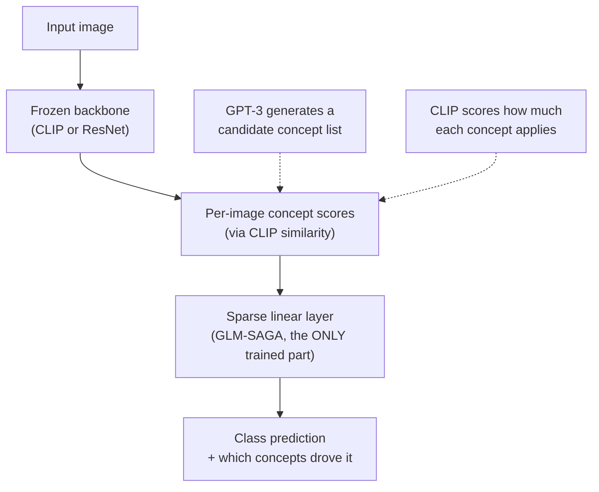
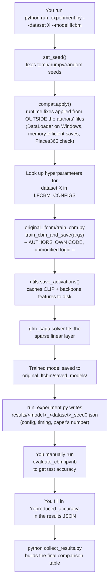
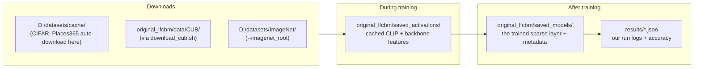

# Workflow & How It Works — LF-CBM Replication

This document explains two things: (1) how the paper's method actually
works end-to-end, and (2) how this repo's code implements and orchestrates
that method. Read this if you need to explain the pipeline in your
presentation or understand what each file is doing and why.

---

## Part 1 — How the paper's method works (conceptually)

Label-Free CBM replaces a black-box image classifier with an **interpretable
two-stage pipeline**: image → concepts → class. Nothing here is invented by
us — this is the authors' method, summarized for clarity.



**Step by step:**

1. **Concept generation (offline, done once by the authors)** — GPT-3 is
   prompted to list plausible visual concepts for the dataset's classes
   (e.g. for CUB birds: "red belly", "curved beak", "striped wings"). These
   lists already ship in `original_lfcbm/data/concept_sets/`, so this repo
   does not call GPT-3 itself.
2. **Concept scoring via CLIP** — for every training image, CLIP (a model
   trained on 400M image-text pairs) scores how well each candidate concept
   matches that image, with zero manual labeling. Concepts that don't
   discriminate well (too similar across classes) get filtered out.
3. **Backbone activation caching** — a separate frozen backbone (ResNet18/50
   or CLIP itself, depending on dataset) extracts a feature vector for every
   image. This is the expensive, slow part — it's a full pass over the
   entire dataset, which is why this step is what actually stalls/crashes
   on limited hardware (see `docs/WINDOWS_TROUBLESHOOTING.md`).
4. **Sparse linear layer training — the only thing actually "trained"** — a
   small linear layer is fit (via a solver called GLM-SAGA) mapping each
   image's concept-activation vector to its class label, with an L1-style
   sparsity penalty so each class only depends on a handful of concepts.
   This is cheap: it's linear algebra on cached feature vectors, not
   backpropagation through a big network.
5. **Evaluation** — test images go through the same frozen backbone → concept
   scoring → sparse layer, and accuracy is measured, plus you can inspect
   *which* concepts drove any individual prediction (the interpretability
   payoff).

**Critical detail for your presentation**: steps 1–3 never update any
weights. The backbone is always frozen (`.eval()`, `torch.no_grad()`
throughout). Only step 4's small linear layer is trained, and it's trained
from scratch (random init) separately for each dataset.

---

## Part 2 — How this repo's code implements that pipeline



**What each file is responsible for:**

| File | Role |
|---|---|
| `run_experiment.py` | **Our wrapper.** Fixes seeds, applies `compat.py`, looks up the correct hyperparameters per dataset, calls into the authors' code, logs the run. This is the file you invoke for Phase 1. |
| `original_lfcbm/train_cbm.py` | **Authors' code, untouched.** Orchestrates: cache activations → filter concepts → fit sparse layer → save model. |
| `original_lfcbm/train_standard.py` | **Authors' code, untouched.** Same idea, but skips the concept step entirely — fits the sparse layer directly on raw backbone features (the "Standard (sparse)" baseline). |
| `original_lfcbm/utils.py` | **Authors' code, untouched.** Activation-caching and saving functions; `compat.py` swaps two of them (and the DataLoader on Windows) in memory at runtime. |
| `original_lfcbm/data_utils.py` | **Authors' code; one edit:** the 8 download-folder paths now point to `D:/datasets/cache`. Defines `DATASET_ROOTS` and loads/preprocesses each dataset. |
| `compat.py` | **Ours.** Runtime fixes (see `docs/WINDOWS_TROUBLESHOOTING.md`); `--no_compat` runs the authors' code exactly as published. |
| `phase2/` | **Ours.** Concept-quality filter, generated trainer (`train_cbm_filtered.py`), runner (`run_phase2.py`), aggregation, rating study. See `docs/PHASE2_PLAN.md`. |
| `collect_results.py` | **Ours.** Reads every `results/*.json`, builds the final paper-vs-reproduced Markdown table. |
| `scripts/imagenet_official/*.py` | **Ours.** One-time data preparation scripts for the official ImageNet download route (nested tar extraction, val set reorganization). |

---

## Part 3 — What happens on disk, end to end



**Why activation caching matters so much in practice**: it's a one-time cost
*per dataset* — once `saved_activations/` has the cached features for a
dataset, rerunning `run_experiment.py` for that same dataset skips
recomputing them (checked via `_all_saved()` / `os.path.exists()` in the
authors' code). This is exactly why, when Places365 crashed at the final
save step after a 6-hour run, the earlier CLIP-feature-caching phase (a
separate ~2.5-hour pass) didn't need to be redone — it had already reached
its own save point successfully.

---

## Part 4 — The three-model comparison, and why only two are ours to run

| Model | What it does | Who trains it |
|---|---|---|
| **Standard** | Plain black-box classifier, no sparsity, no concepts | Not trained by this codebase — a reference figure from the backbone's own established accuracy |
| **Standard (sparse)** | Sparse linear layer directly on raw backbone features, no concepts | `train_standard.py` |
| **Label-free CBM** | Sparse linear layer on CLIP-derived *concept* scores | `train_cbm.py` |

Comparing row 2 → row 3 isolates the cost of interpretability (routing
through named concepts instead of raw features); comparing row 1 → row 2
isolates the cost of sparsity alone. This project reproduces rows 2 and 3,
matching exactly what the authors provide training code for.

---

## Quick command reference tying it all together

```powershell
# One dataset, one model, from raw data to a logged run:
python run_experiment.py --dataset cifar10 --model lfcbm --seed 0 --batch_size 64

# Get test accuracy for that run (manual step, not automated):
jupyter notebook original_lfcbm\evaluate_cbm.ipynb
# -> paste the number into results\lfcbm_cifar10_seed0.json under "reproduced_accuracy"

# Once you've done this for whichever datasets/models you completed:
python collect_results.py
# -> writes results\comparison_table.md, your Phase 1 deliverable table
```
